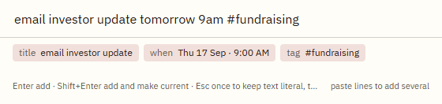
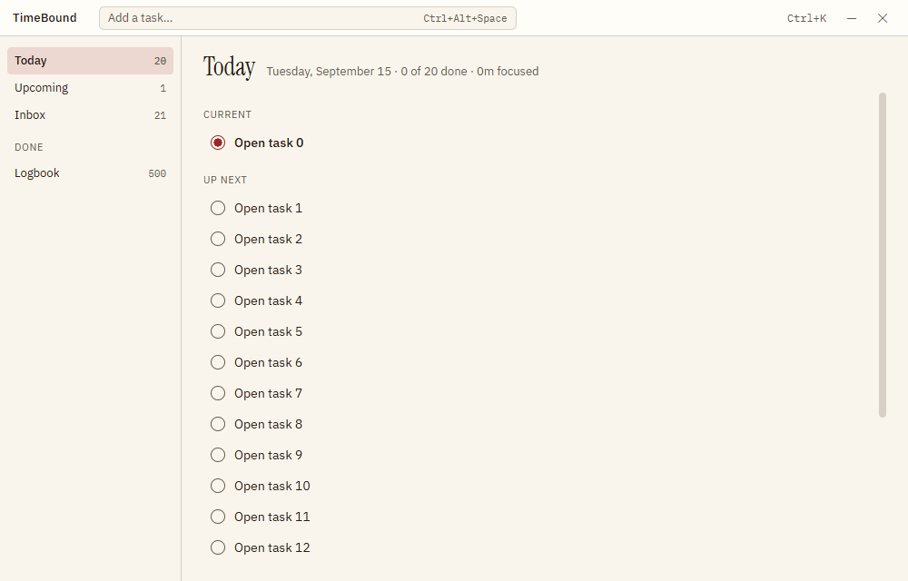
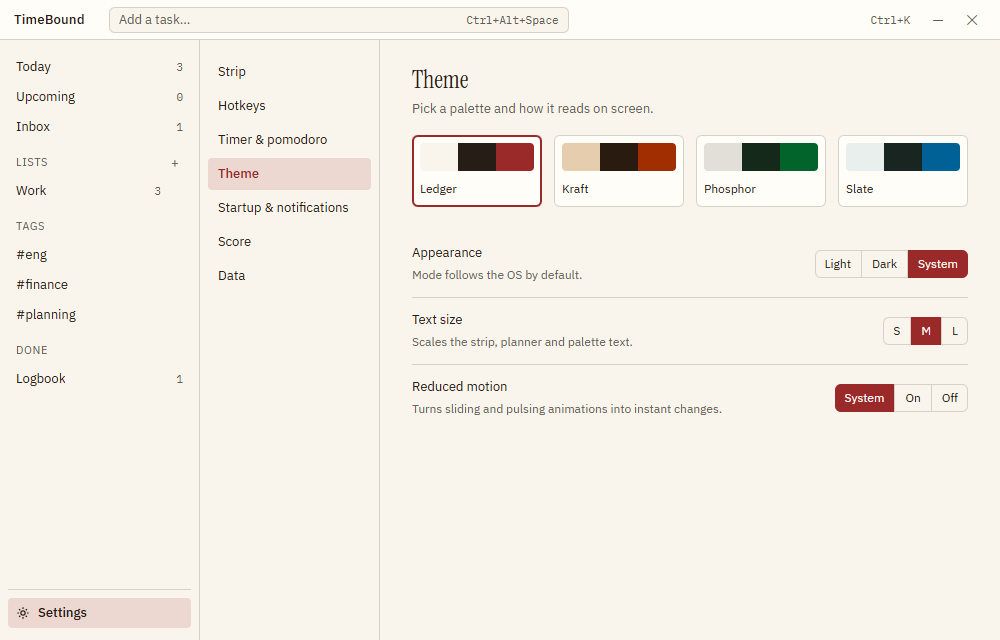

# TimeBound

TimeBound keeps the task you are doing right now in front of you. A 32 px strip sits at the edge of your screen, above everything else, showing that one task and its timer. Behind it is a keyboard-first planner with lists, tags, sub-tasks, repeats, snooze, daily planning and pomodoro. Your data stays in a folder on your machine. No account, no sync, no network calls.

Windows 11 and macOS.


That is the whole interface most of the day. Press a key when you want more.

## What it does

**The strip.** Docks to the top or bottom edge, remembers its position per monitor, never covers the taskbar and never takes focus from what you are typing in. It can auto-hide and peek when you touch the edge, collapse to a 24 px pill, fade its backplate, pass clicks straight through to the window underneath, hide itself from screen sharing, and reserve its own screen space so maximised windows stop short of it. It hides over full-screen apps, and it knows the difference between a real full-screen app and the Start menu.

**Capture.** One hotkey from anywhere opens a capture field that reads what you type: `call Priya tomorrow 3pm #work every weekday` becomes a task, a time, a tag and a repeat, shown as chips before you commit.



**The planner.** Today, Upcoming, Inbox, your lists, your tags and the Logbook. Every action has a key: `j`/`k` to move, `Space` to complete, `e` to rename, `t` for today, `s` to snooze, `d` for a due date, `m` to move, `Shift+↑/↓` to reorder, `g` then a letter to jump, and `Ctrl+K` for the command palette. Drag works too. So does undo.



**Rituals.** Plan today pulls forward what rolled over and asks what else belongs in the day. Close the day records what you finished and a note. The day turns over at 4am, not midnight, so a task finished at 1am still counts for the night you were working.

**Timers.** Plan minutes per task, start and pause from the strip, the tray or a hotkey, with optional pomodoro breaks. Timers pause themselves when you step away or the machine sleeps.

**Four themes**, light and dark, all meeting AA contrast: Ledger, Kraft, Phosphor and Slate.



More screenshots: [docs/screenshots/INDEX.md](docs/screenshots/INDEX.md).

## Install

Download `TimeBound Setup 2.0.0-alpha.0.exe` and run it. The installer is **not code-signed**, so Windows SmartScreen will warn you: choose More info, then Run anyway. Signing needs a paid certificate, which is an open decision.

On macOS, build the DMG yourself with `npm run package:mac`. The macOS build has not been run on real hardware yet.

## Hotkeys

These are global and can be changed in Settings.

| Action | Windows | macOS |
| --- | --- | --- |
| Quick capture | `Ctrl+Alt+Space` | `⌃⌥Space` |
| Show or hide the strip | `Ctrl+Alt+Shift+Space` | `⌃⌥⇧Space` |
| Complete and advance | `Ctrl+Alt+Enter` | `⌃⌥Enter` |
| Start or pause the timer | `Ctrl+Alt+Shift+Enter` | `⌃⌥⇧Enter` |
| Undo | `Ctrl+Alt+Backspace` | `⌃⌥Delete` |

Inside the planner, `Ctrl+K` (`⌘K`) opens the command palette and `Ctrl+,` (`⌘,`) opens Settings.

## Your data

Everything lives in one JSON file you can read, copy and back up yourself:

- Windows: `%APPDATA%\TimeBound\data.json`
- macOS: `~/Library/Application Support/TimeBound/data.json`

Settings lets you move that folder anywhere, including a synced one. Saves are atomic, a daily backup is kept, and a copy of your current data is written before any backup is restored. Export and import are plain JSON or Markdown. If you used TimeBound 1.x, its `state.json` is imported on first run and never modified or deleted.

**Privacy.** TimeBound makes no network calls. There is no telemetry, no analytics, no crash reporting and no account. Nothing you type leaves your machine.

## Build from source

```
npm install
npm run dev          # Vite + Electron with live reload
npm run build        # main, preload and renderer into dist/
npm test             # Vitest, run under two time zones
npm run e2e          # Playwright drives the built app
npm run package      # unsigned Windows installer into release/
npm run package:mac  # DMG, must run on macOS
```

Two local gotchas. If Electron starts as plain Node and complains about `requestSingleInstanceLock`, your shell has `ELECTRON_RUN_AS_NODE=1` set; unset it. If Playwright cannot launch the app and `node_modules/electron/dist` is missing, run `node node_modules/electron/install.js` once.

## How it is built

A pure core (`src/core/`) of reducers that take the clock as an argument, a main process that owns the data and the windows, and three renderer windows (strip, palette, planner) that are sandboxed and talk to main over validated IPC. Tests: 891 unit tests plus 42 end-to-end tests that drive the real app.

- [DESIGN.md](DESIGN.md) — the visual system.
- [docs/PLAN.md](docs/PLAN.md) — what was built, in order.
- [docs/DECISIONS.md](docs/DECISIONS.md) — why, including every dependency.
- [docs/FOOTPRINT.md](docs/FOOTPRINT.md) — how much screen the strip actually takes.
- [CHANGELOG.md](CHANGELOG.md).

## Status

Alpha. The Windows build is tested on Windows 11. The macOS build compiles and is packaged but has not been run on a Mac. TimeBound is free and has no paid tier; there is a single licensing seam in the code so one could be added later without touching anything else.
